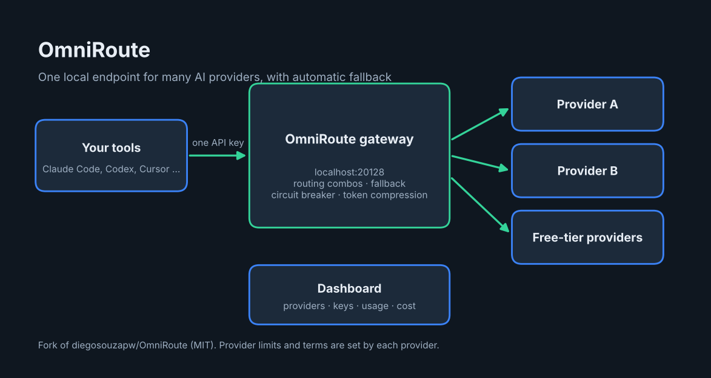

# OmniRoute: overview



**OmniRoute** is a free, open-source AI gateway that runs on your machine. Your coding tools talk to one local endpoint, and OmniRoute routes each request to a healthy, available provider, with automatic fallback when a provider fails or runs out of quota.

Upstream project: [diegosouzapw/OmniRoute](https://github.com/diegosouzapw/OmniRoute), license MIT. This repository is a fork.

## What it does

- One endpoint (default `http://localhost:20128`) compatible with OpenAI-, Claude- and Gemini-style APIs.
- Routing "combos" with several strategies, and an `auto` model that builds a combo from the providers you connected.
- Three resilience layers: provider circuit breaker, per-connection cooldown, per-model lockout.
- Token compression, an MCP server, an A2A server, and a web dashboard for providers, keys, usage and cost.

## Install and use with Claude Code

```bash
npm install -g omniroute
omniroute
omniroute setup-claude
```

Requires Node.js 22.22.2 or newer (below 23), or Node 24 or newer. In the dashboard, connect a provider and create an OmniRoute API key. Claude Code uses the gateway root without `/v1`:

```json
{"env": {"ANTHROPIC_BASE_URL": "http://localhost:20128", "ANTHROPIC_AUTH_TOKEN": "sk-your-omniroute-key"}}
```

See also [WHAT-IS-OMNIROUTE.md](./WHAT-IS-OMNIROUTE.md) for the longer plain-English explanation.

## Things to know

- Free-tier limits and terms belong to each provider. Providers marked `tos: avoid` are excluded from automatic routing by default.
- OmniRoute stores provider credentials. Run it locally, or behind authentication if you expose it.

---

Overview prepared by Ashraf Saed | MIGATRONIX. The project itself belongs to its original authors; see its license.

## Automatic install

```bash
git clone https://github.com/AshrafSaed/omniroute-guide.git
cd omniroute-guide
bash install.sh
```

Or open this folder in Claude Code and say "install omniroute": the skill `install-omniroute` (in `.claude/skills/`) runs the same script.

- Follows upstream README (`npm install -g omniroute`). After install you connect providers in the dashboard (default http://localhost:20128). Starting the server and adding provider accounts is left to you.
- After install: Run `omniroute --help`, then start it as the upstream README describes and open http://localhost:20128.
